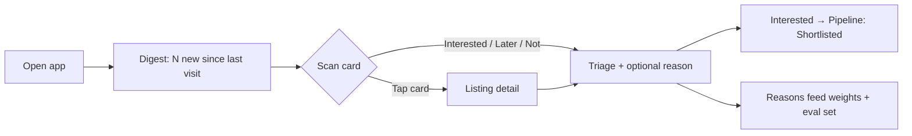
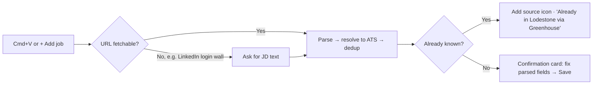

# Lodestone — UX Spec (M2)

| | |
|---|---|
| **Owner** | Claude (UX, under PM), for Ayush's review |
| **Status** | v0, in review (gate M2) |
| **Implements** | [PRD v0](../PRD.md) P0 requirements R1–R15, CUJ-1 to CUJ-7 |
| **Prototype** | [prototype.html](prototype.html) (open locally, or via the published link in the tracker) |

---

## 1. Design principles

1. **Glanceable in 5 minutes on an iPad.** The digest comes first. Tap targets are at least 44px, and nothing needs hover.
2. **Never hide, always label.** Estimates ("est."), inferred signals and unknowns are visible and marked. Filters never drop a job just because data is missing (D-021).
3. **Explain every number.** The fit score expands into sub-scores, each with a one-line reason.
4. **Two taps to triage.** Interested, Later and Not are always visible. Reasons are optional chips.
5. **Every claim links to its source.** Source icons, "found on" entries and pathway-signal sources are deep links (the exact posting, dataset or official page). Jargon (role tier, LMIA, CEC, Stated/Inferred/Unknown) is explained in place via a "What do these labels mean?" panel. (Ayush's review, 2026-10-14)
6. **Built for one, ready for many.** Every preference lives in Settings as data, not code (D-005).

## 2. Information architecture

```
Lodestone
├── Digest (home)            CUJ-2, CUJ-4: top N new matches (default 20, 1–100), then all ranked
│   └── Listing detail       CUJ-3: fit breakdown, pay, pathway signals, sources, actions
├── Pipeline                 CUJ-6: Discovered → Shortlisted → Applied → Screen → Interviewing → Offer → Closed
├── Add job (global)         CUJ-5: paste URL(s) or JD text from anywhere (Cmd/Ctrl+V or the + button)
├── Companies                CUJ-7: watchlist, discovery candidates, source health
└── Settings                 CUJ-1
    ├── Profile              CV-derived profile, editable
    ├── Preferences          locations, work mode, role families, pay filter, toggles, digest size
    └── Advanced             score weights (sum to 100%)
```

**Navigation:** a bottom tab bar on iPad and phone, a left rail on desktop. "+ Add job" is always reachable from the top bar.

## 3. Key flows





## 4. Screen specs

### 4.1 Digest (home)
- **Header:** "N new since your last visit", digest size, and active filter chips (tap to edit)
- **Job card:** title · company · location and work mode · posting age · **fit score** (0–100, with a ring) · **source icons** (one per source, A1) · **pay** (as posted, or an estimate with an "est." icon, B8) · **pathway chips** (ICT, Sponsorship, Sponsored before, GTS, CEC credit), each marked Stated / Inferred / Unknown · **Internal transfer** badge (B10) · repost or "no longer live" flags · triage buttons
- **Sort:** fit (default), newest, pay. **Group:** "New" (the top N), then "Earlier"

### 4.2 Listing detail
- Parsed summary (role family and tier, level signals, domain, must-haves, people management)
- **Fit breakdown:** six sub-scores with bars, weights and a reason for each. The overall score is the weighted blend
- **Pay:** posted range, or estimate plus its confidence and source tier (DR-2)
- **Pathway signals table:** signal, status (Stated / Inferred / Unknown), **linked** source (e.g. the ESDC dataset, the posting, IRCC rules), as-of date. Footer: "Signals, not immigration advice"
- **Sources:** every sighting with first seen, last seen and a link
- Actions: Open posting · Add to pipeline · Triage

### 4.3 Add job
- One input that takes **one or more URLs, or pasted JD text**. Cmd/Ctrl+V anywhere opens it pre-filled
- States: parsing → **confirmation card** (editable fields) → saved; **already known** (adds the source icon); **can't fetch** (asks for JD text)
- Coaching tips (A3h): "Found a role on LinkedIn? Copy the link and press Cmd+V here."

### 4.4 Pipeline
- Kanban with seven stages. Cards show fit, pay and a **no longer live** flag
- Drag (desktop) or a stage menu (touch) to move. Closed postings keep their history

### 4.5 Companies
- **Watchlist:** company, segment, discovery pathway(s), ATS, open Canadian roles, last refresh, mute/block
- **Candidates:** discovered companies waiting for review (ATS not found, or Canada presence unclear)
- **Source health:** each source with last success, item count and errors

### 4.6 Settings
- **Profile:** fields extracted from the CV (current employer, roles, scope signals, domains, skills). All editable
- **Preferences:** locations (GTA + Waterloo, expand to Canada) · work mode · role families by tier · pay range (CAD) · **include roles without posted pay** · **exclude people-management roles** · digest size (1–100, default 20)
- **Advanced:** six weight sliders that always sum to 100%, plus "Reset to defaults"

## 5. Visual direction

- **Theme:** "magnetite and survey map." Cool mineral neutrals with a slight blue-grey bias, and one deep ore-blue accent for primary actions and scores. Semantic colors (good, caution, unknown) are separate from the accent. Light and dark themes are both designed.
- **Type:** a characterful grotesque for headings and the wordmark, a highly legible sans for body text, and a mono face for numbers (scores, pay, dates) with tabular figures.
- **Signature detail:** the fit score is drawn as a **compass ring**. Fill shows the score, and the needle points "true north" at 100. It's used sparingly: on cards and in the detail header.

## 6. Accessibility

- WCAG AA contrast in both themes. Status is never shown by color alone (chips always carry text)
- Visible focus states. Full keyboard support on desktop: **J/K** to move, **I/L/N** to triage, **Enter** to open, **Cmd/Ctrl+V** to add a job
- Respects `prefers-reduced-motion`

## 7. Open questions for the UX review

1. Does the card show the right things at a glance, or is it too dense on iPad?
2. Should "Later" items come back in a future digest, e.g. after 7 days?
3. Should the pipeline auto-add Interested roles to Shortlisted (current behaviour), or keep them separate?
