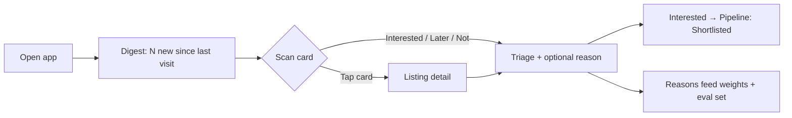
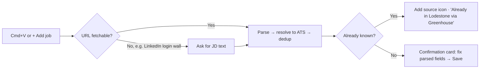

# Lodestone — UX Spec (M2)

| | |
|---|---|
| **Owner** | Claude (UX, under PM), for Ayush's review |
| **Status** | v0, in review (gate M2) |
| **Implements** | [PRD v0](../PRD.md) P0 requirements R1–R15, CUJ-1 to CUJ-7 |
| **Prototype** | [prototype.html](prototype.html) (open locally, or via the published link in the tracker) |

---

## 1. Design principles

1. **Glanceable in 5 minutes on an iPad.** The digest comes first. Tap targets are at least 44px, and nothing needs hover.
2. **Never hide, always label.** Estimates ("est."), inferred signals and unknowns are visible and marked. Filters never drop a job just because data is missing (D-021).
3. **Explain every number.** The fit score expands into sub-scores, each with a one-line reason.
4. **Two taps to triage.** Interested, Later and Not are always visible. Reasons are optional chips.
5. **Every claim links to its source.** Source icons, "found on" entries and pathway-signal sources are deep links (the exact posting, dataset or official page). Jargon (role tier, LMIA, CEC, Stated/Inferred/Unknown) is explained in place via a "What do these labels mean?" panel. (Ayush's review, 2026-10-14)
6. **Built for one, ready for many.** Every preference lives in Settings as data, not code (D-005).

## 2. Information architecture

```
Lodestone
├── Digest (home)            CUJ-2, CUJ-4: top N new matches (default 20, 1–100), then all ranked
│   └── Listing detail       CUJ-3: fit breakdown, pay, pathway signals, sources, actions
├── Pipeline                 CUJ-6: Discovered → Shortlisted → Applied → Screen → Interviewing → Offer → Closed
├── Add job (global)         CUJ-5: paste URL(s) or JD text from anywhere (Cmd/Ctrl+V or the + button)
├── Companies                CUJ-7: watchlist, discovery candidates, source health
└── Settings                 CUJ-1
    ├── Profile              CV-derived profile, editable
    ├── Preferences          locations, work mode, role families, pay filter, toggles, digest size
    └── Advanced             score weights (sum to 100%)
```

**Navigation:** a bottom tab bar on iPad and phone, a left rail on desktop. "+ Add job" is always reachable from the top bar.

## 3. Key flows





## 4. Screen specs

### 4.1 Digest (home)
- **Header:** "N new since your last visit", digest size, and active filter chips (tap to edit)
- **Job card:** title · company · location and work mode · posting age · **fit score** (0–100, with a ring) · **source icons** (one per source, A1) · **pay** (as posted, or an estimate with an "est." icon, B8) · **pathway chips** (ICT, Sponsorship, Sponsored before, GTS, CEC credit), each marked Stated / Inferred / Unknown · **Internal transfer** badge (B10) · repost or "no longer live" flags · triage buttons
- **Sort:** fit (default), newest, pay. **Group:** "New" (the top N), then "Earlier"

### 4.1a Freshness panel (R11a)
- A header chip on every screen: "Updated 2h ago". Tap it to open a panel listing job pulls (overall and per source), scoring (time, prompt and model version), pathway signals (ESDC quarter), discovery and profile, each with a timestamp. Items older than 7 days are flagged.

### 4.2 Listing detail (updated 10-16, D-065)
A side drawer (full screen on phones). **Header, always visible:** role type (Core PM / PM-adjacent / Stretch with what it means), title, company and location, then the actions: Interested · Later · Not for me · **Open posting ↗** (full width on phones).

Below the header, three **tabs** (ARIA tabs; arrow keys move between them; the bar sticks to the top while you scroll). The tab you pick stays selected as you move between roles with J/K, so you can read descriptions one after another.
1. **Summary** (default, for deciding): against-your-preferences checks with reasons; fit breakdown (sub-scores, weights, reasons); posting facts (location, work mode, team, posted, experience asked, people management); pay (posted ranges, estimate, equity, market check); work-permit signals table with status and linked source ("Signals, not immigration advice"); every source with live/gone; pipeline stage and notes.
2. **Job description** (for reading): the posting as written, formatted (headings, bullet lists, paragraphs), with the sentences Lodestone used for **years of experience and pay highlighted** so you can check them in context. Header line: which site it's from, when it was read, and a link to the original. Legal notices (equal opportunity, accommodation, privacy) are left out with a one-line note; very long postings are cut at about 12,000 characters with a link to the rest. Loaded only when the tab opens (the digest stays fast). States: loading · couldn't load (link to original) · not read (link to original).
3. **Company & team** (for context): **About the company**: its own "About us" text from its postings ("In its own words"), or a short **Summary by Claude** labelled as possibly dated when its postings don't describe it; facts: open roles in Lodestone (with "See all", which filters the digest to that company), where in Canada, work-permit evidence, careers site. **The team**: the posting's team name and its "About the team" section when there is one; otherwise says plainly that the posting doesn't describe the team.

Why tabs: the Summary is what you decide on and was already long; descriptions run 7,000–11,000 characters. Putting them in their own tab keeps the decision view short and the reading view uninterrupted, on the iPad as well as the laptop.

### 4.3 Add job
- One input that takes **one or more URLs, or pasted JD text**. Cmd/Ctrl+V anywhere opens it pre-filled
- States: parsing → **confirmation card** (editable fields) → saved; **already known** (adds the source icon); **can't fetch** (asks for JD text)
- Coaching tips (A3h): "Found a role on LinkedIn? Copy the link and press Cmd+V here."

### 4.4 Pipeline
- Kanban with seven stages. Cards show fit, pay and a **no longer live** flag
- Drag (desktop) or a stage menu (touch) to move. Closed postings keep their history

### 4.5 Companies
- **Watchlist:** company, segment, discovery pathway(s), ATS, open Canadian roles, last refresh, mute/block
- **Candidates:** discovered companies waiting for review (ATS not found, or Canada presence unclear)
- **Source health:** each source with last success, item count and errors

### 4.6 Settings
- **Profile:** fields extracted from the CV (current employer, roles, scope signals, domains, skills). All editable
- **Preferences:** locations (GTA + Waterloo, expand to Canada) · work mode · role families by tier · pay range (CAD) · **include roles without posted pay** · **exclude people-management roles** · digest size (1–100, default 20)
- **Advanced:** six weight sliders that always sum to 100%, plus "Reset to defaults"

## 5. Visual direction

- **Theme:** "magnetite and survey map." Cool mineral neutrals with a slight blue-grey bias, and one deep ore-blue accent for primary actions and scores. Semantic colors (good, caution, unknown) are separate from the accent. Light and dark themes are both designed.
- **Type:** a characterful grotesque for headings and the wordmark, a highly legible sans for body text, and a mono face for numbers (scores, pay, dates) with tabular figures.
- **Signature detail:** the fit score is drawn as a **compass ring**. Fill shows the score, and the needle points "true north" at 100. It's used sparingly: on cards and in the detail header.

## 6. Accessibility

- WCAG AA contrast in both themes. Status is never shown by color alone (chips always carry text)
- Visible focus states. Full keyboard support on desktop: **J/K** to move, **I/L/N** to triage, **Enter** to open, **Cmd/Ctrl+V** to add a job
- Respects `prefers-reduced-motion`

## 7. UX review questions (resolved 2026-10-14)

1. Card density on iPad: **fine as is.** The card shows the right things at a glance (D-030).
2. "Later" roles **come back in the digest after 7 days** (adjustable in Settings) (D-031).
3. Marking a role **Interested adds it to Shortlisted** in the pipeline automatically (D-032).
