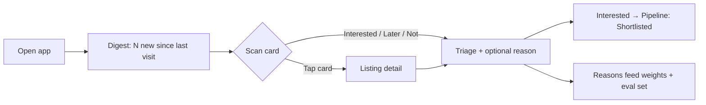
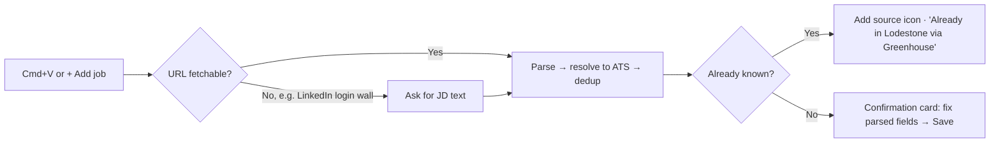

# Lodestone — UX Spec (M2)

| | |
|---|---|
| **Owner** | Claude (UX, under PM), for Ayush's review |
| **Status** | v0 approved at M2 (D-033); §8 v2 added 10-16 |
| **Implements** | [PRD v0](../PRD.md) P0 requirements R1–R15, CUJ-1 to CUJ-7 |
| **Prototype** | [prototype.html](prototype.html) (open locally, or via the published link in the tracker) |

---

## 1. Design principles

1. **Glanceable in 5 minutes on an iPad.** The digest comes first. Tap targets are at least 44px, and nothing needs hover.
2. **Never hide, always label.** Estimates ("est."), inferred signals and unknowns are visible and marked. Filters never drop a job just because data is missing (D-021).
3. **Explain every number.** The fit score expands into sub-scores, each with a one-line reason.
4. **Two taps to triage.** Interested, Later and Not are always visible. Reasons are optional chips.
5. **Every claim links to its source.** Source icons, "found on" entries and pathway-signal sources are deep links (the exact posting, dataset or official page). Jargon (role tier, LMIA, CEC, Stated/Inferred/Unknown) is explained in place via a "What do these labels mean?" panel. (Ayush's review, 2026-10-14)
6. **Built for one, ready for many.** Every preference lives in the Profile as data, not code (D-005).

## 2. Information architecture

```
Lodestone
├── Digest (home)            CUJ-2, CUJ-4: top N new matches (default 20, 1–100), then all ranked
│   └── Listing detail       CUJ-3: fit breakdown, pay, pathway signals, sources, actions
├── Pipeline                 CUJ-6: Discovered → Shortlisted → Applied → Screen → Interviewing → Offer → Closed
├── Add job (global)         CUJ-5: paste URL(s) or JD text from anywhere (Cmd/Ctrl+V or the + button)
├── Companies                CUJ-7: watchlist, discovery candidates, source health
└── Profile                  CUJ-1 (was Settings, D-061)
    ├── Profile              CV-derived profile, editable
    ├── Preferences          locations, work mode, role families, pay filter, toggles, digest size
    └── Advanced             score weights (sum to 100%)
```

**Navigation:** a bottom tab bar on iPad and phone, a left rail on desktop. "+ Add job" is always reachable from the top bar.

## 3. Key flows





## 4. Screen specs

### 4.1 Digest (home)
- **Header:** "N new since your last visit", digest size, and active filter chips (tap to edit)
- **Job card:** title · company · location and work mode · posting age · **fit score** (0–100, with a ring) · **source icons** (one per source, A1) · **pay** (as posted, or an estimate with an "est." icon, B8) · **pathway chips** (ICT, Sponsorship, Sponsored before, GTS, CEC credit), each marked Stated / Inferred / Unknown · **Internal transfer** badge (B10) · repost or "no longer live" flags · triage buttons
- **Sort:** fit (default), newest, pay. **Group:** "New" (the top N), then "Earlier"

### 4.1a Freshness panel (R11a)
- A header chip on every screen: "Updated 2h ago". Tap it to open a panel listing job pulls (overall and per source), scoring (time, prompt and model version), pathway signals (ESDC quarter), discovery and profile, each with a timestamp. Items older than 7 days are flagged.

### 4.2 Listing detail (updated 10-16, D-065)
A side drawer (full screen on phones). **Header, always visible:** role type (Core PM / PM-adjacent / Stretch with what it means), title, company and location, then the actions: Interested · Later · Not for me · **Open posting ↗** (full width on phones).

Below the header, three **tabs** (ARIA tabs; arrow keys move between them; the bar sticks to the top while you scroll). The tab you pick stays selected as you move between roles with J/K, so you can read descriptions one after another.
1. **Summary** (default, for deciding): against-your-preferences checks with reasons; fit breakdown (sub-scores, weights, reasons); posting facts (location, work mode, team, posted, experience asked, people management); pay (posted ranges, estimate, equity, market check); work-permit signals table with status and linked source ("Signals, not immigration advice"); every source with live/gone; pipeline stage and notes.
2. **Job description** (for reading): the posting as written, formatted (headings, bullet lists, paragraphs), with the sentences Lodestone used for **years of experience and pay highlighted** so you can check them in context. Header line: which site it's from, when it was read, and a link to the original. Legal notices (equal opportunity, accommodation, privacy) are left out with a one-line note; very long postings are cut at about 12,000 characters with a link to the rest. Loaded only when the tab opens (the digest stays fast). States: loading · couldn't load (link to original) · not read (link to original).
3. **Company & team** (for context): **About the company**: its own "About us" text from its postings ("In its own words"), or a short **Summary by Claude** labelled as possibly dated when its postings don't describe it; facts: open roles in Lodestone (with "See all", which filters the digest to that company), where in Canada, work-permit evidence, careers site. **The team**: the posting's team name and its "About the team" section when there is one; otherwise says plainly that the posting doesn't describe the team.

Why tabs: the Summary is what you decide on and was already long; descriptions run 7,000–11,000 characters. Putting them in their own tab keeps the decision view short and the reading view uninterrupted, on the iPad as well as the laptop.

### 4.3 Add job
- One input that takes **one or more URLs, or pasted JD text**. Cmd/Ctrl+V anywhere opens it pre-filled
- States: parsing → **confirmation card** (editable fields) → saved; **already known** (adds the source icon); **can't fetch** (asks for JD text)
- Coaching tips (A3h): "Found a role on LinkedIn? Copy the link and press Cmd+V here."

### 4.4 Pipeline
- Kanban with seven stages. Cards show fit, pay and a **no longer live** flag
- Drag (desktop) or a stage menu (touch) to move. Closed postings keep their history

### 4.5 Companies
- **Watchlist:** company, segment, discovery pathway(s), ATS, open Canadian roles, last refresh, mute/block
- **Candidates:** discovered companies waiting for review (ATS not found, or Canada presence unclear)
- **Source health:** each source with last success, item count and errors

### 4.6 Profile (was Settings, D-061)
- **Profile:** fields extracted from the CV (current employer, roles, scope signals, domains, skills). All editable
- **Preferences:** locations (GTA + Waterloo, expand to Canada) · work mode · role families by tier · pay range (CAD) · **include roles without posted pay** · **exclude people-management roles** · digest size (1–100, default 20)
- **Advanced:** six weight sliders that always sum to 100%, plus "Reset to defaults"

## 5. Visual direction

- **Theme:** "magnetite and survey map." Cool mineral neutrals with a slight blue-grey bias, and one deep ore-blue accent for primary actions and scores. Semantic colors (good, caution, unknown) are separate from the accent. Light and dark themes are both designed.
- **Type:** a characterful grotesque for headings and the wordmark, a highly legible sans for body text, and a mono face for numbers (scores, pay, dates) with tabular figures.
- **Signature detail:** the fit score is drawn as a **compass ring**. Fill shows the score, and the needle points "true north" at 100. It's used sparingly: on cards and in the detail header.

## 6. Accessibility

- WCAG AA contrast in both themes. Status is never shown by color alone (chips always carry text)
- Visible focus states. Full keyboard support on desktop: **J/K** to move, **I/L/N** to triage, **Enter** to open, **Cmd/Ctrl+V** to add a job
- Respects `prefers-reduced-motion`

## 7. UX review questions (resolved 2026-10-14)

1. Card density on iPad: **fine as is.** The card shows the right things at a glance (D-030).
2. "Later" roles **come back in the digest after 7 days** (adjustable in the Profile) (D-031).
3. Marking a role **Interested adds it to Shortlisted** in the pipeline automatically (D-032).

## 8. UX v2: end-to-end flow and onboarding (10-16, D-066, D-067)

Lodestone is for **people moving countries for work** (D-066). Many arrive without a ready resume, or with one they'd rather not share yet. v2 is designed from their point of view: show value before asking for effort, ask one thing at a time, and let every action quietly sharpen the matches.

### 8.1 Who arrives, and what they're thinking
| Person | In their head | What the design does |
|---|---|---|
| No resume ready | "Let me see what's out there first" | Three ways to say what they want, none needs a resume |
| Half-baked resume | "It undersells me; matches will be wrong" | Resume comes later, as an upgrade, with "a rough draft is fine" and an editable "what we understood" |
| Privacy-wary | "Where does this go? Why ask my status?" | Privacy promise on the first screen; every question says why it's asked |
| Busy, on a phone | "5 minutes, show me something" | Real roles in about a minute; one question per screen |
| Unsure of status | "I don't know what permit I'd need" | "Not sure" is a first-class answer with a short explainer |
| Citizen or PR | "Is this for me?" | Yes: the work-permit layer hides; nothing feels "not for them" |

### 8.2 Principles (extends §1)
1. **Value before effort.** Real roles on screen within a minute; ask for more only after showing why.
2. **One clear next action per screen.**
3. **Every signal is a free answer.** Taps, reasons, reading and pipeline moves teach the ranking; no tuning forms.
4. **Show the learning** in plain words ("Ranked higher: like 3 AI-platform roles you shortlisted").
5. **Explain on screen, never on hover.**
6. **The user is in control.** Everything inferred is visible, editable and can be switched off.

### 8.3 Onboarding (first visit)
1. **Welcome.** Promise: *"Find the jobs that fit you, in the country you want to move to, and the ones that will actually hire you."* Privacy line: "Everything you tell us stays private to you. Nothing is shared with employers." Button: **Get started**.
2. **Where do you want to work?** Country (Canada live; others "coming soon: tell us where", recorded as demand), then cities or "anywhere in the country / remote".
3. **Can you already work there?** "Yes, I'm a citizen or permanent resident" · "I have an open work permit" · "I'll need sponsorship" · "Not sure" (treated as needing sponsorship, with a two-line explainer). "We use this only to show which employers hire people from abroad."
4. **What kind of role?** Three ways, none needs a resume: type it in your own words ("senior PM, fintech, ~8 years"); paste a job you'd love; or "Not sure, show me examples" (tap role-family cards). Fields not covered yet get an honest "We don't cover this yet; want us to tell you when we do?"
5. **Quick taste test (8 real roles, skippable).** Interested / not for each. Feels like browsing, and every tap trains the ranking.
6. **Your list.** Banner: "Based on 3 answers and 8 taps. Your personalised ranking arrives at the next run (within about 6 hours) and gets sharper as you use Lodestone." (Scoring runs in the scheduled runs, not on the viewer's Claude usage: Ayush, 10-16.) Until then the list is filtered by destination, status and role and sorted by the taste test and recency.

### 8.4 The profile, later, as an upgrade
Offered after the first session, or when a user opens a role's fit details ("Fit: not personal yet"). "Want sharper matches? Add your experience to see how it fits each role." Reassurance in plain words: a rough draft is fine; only you can see it; never sent to employers; delete it any time. Three ways:
- **Upload** a resume (PDF or text).
- **Paste** any text (even a LinkedIn "About" section and job titles).
- **Build it with me** (MVP): about five short questions (current role and level, years, biggest win, domains, tools). Answers are saved instantly; the profile is built at the next run (within about 6 hours). The resulting summary can also be copied as a starting point for a resume.
After it's read: **"Here's what we understood"**, every line editable, so a weak resume never has the last word.

### 8.5 Match quality grows with signals
| Level | What we know | What the user gets |
|---|---|---|
| 0 Answers | Destination, status, role in their words | Filtered list with work-permit signals, newest first |
| 1 Taste test | ~8 likes and dislikes | Ranking by similarity to what they liked |
| 2 Profile | Experience, level, domains (resume, text or build-with-me) | Fit scores with plain reasons |
| 3 Daily use | Triage, "Not for me" reasons, what they open and read | Rankings that learn; one-tap suggestions |
| 4 Applying | Pipeline moves | Nudges, follow-ups, pay checks |
Shown on the Profile page as a meter: "Match quality: level 2 of 4 · Triage 10 more roles to reach level 3."

### 8.6 Learning from signals (Q-23)
- **Explicit:** Interested, Later, Not for me + reason, pipeline moves, market-check requests.
- **Reading time** on the Job description tab (and opening the original posting), capped per role, **with an off switch** in the Profile ("Learn from what I read").
- **Preference suggestions, one tap to accept** (never applied silently): after three "Pay too low", "Raise your pay target to CA$190K? · Accept · Not now". Accepted changes show in the Profile with their reason and can be undone.
- **More / less like this** acts on the pattern (domain, company type, level), not only the one role.
- **Exploration:** about 1 card in 10 is outside the user's pattern, labelled "Something different".
- **Explain:** each card can say why it's ranked where it is, in a sentence.

### 8.7 Ask only when it matters (one-tap questions)
Asked once, at the moment they're relevant, each dismissible: first "Pay too low" → minimum base pay; three people-manager dismissals → hide manager roles?; shortlisting a role outside the user's regions → add that city?; a role at the user's current employer → count transfers as a strong route?

### 8.8 The daily loop
- **Today:** "N new for you" (default up to 10), a short stack you can finish ("All caught up" when done). The full ranked backlog is one tap away under "All roles".
- **Evaluate:** the role view (§4.2) plus "why it's ranked here" and more / less like this.
- **Act:** Interested opens a gentle next step: Open posting · Request market check · Add a note.
- **Track:** pipeline with nudges ("Applied 10 days ago: follow up?") and closed-posting alerts.
- **Weekly (not built yet, §8.9):** a Monday "Your week": market changes, what Lodestone learned about you, companies to consider.

### 8.15 Type scores and role-first setup (10-17, D-077)
Ayush's questions: a "Program Manager" job can really be product work (and the reverse), so a job can be more than one
type; and the simplest setup is to ask only the role type, rank on that, and nudge for the rest.
- **Type scores:** each job has 0–100 per role family, from Claude reading the description once (`docs/eng/TYPE_SCORES.md`);
  until then the title gives a first guess (85 for the family it names, marked "estimated from the title").
  Relevance to you = the best type score over your families and the ones you asked to see (related ×0.85, others ×0.7).
  Shown, and scored for you, from 50. The tag shows the main type plus "also X" when a second type is 50+; hovering
  lists the scores. The role-type filter counts a job under every type it scores 50+ on. The "role" part of fit comes
  from relevance once types are read, so changing your field is instant.
- **Setup:** welcome → **role type first** ("What kind of role?", cards or own words) → **Show my jobs**, or "Answer 2
  more quick questions" (where, work status; each skippable, "Show my jobs now" always visible). Taste test moved out
  of setup: a link on the first-list banner and a nudge. Not answered: all of Canada; work status "not set", and
  work-permit tags never turn red (information only). On phones the setup buttons stay pinned above the tab bar.
- **Level 1 ranking** (role type only): relevance, then freshness, then whether pay is posted; the banner says
  "Ranked by role type only. Each thing you add sharpens it."
- **Nudges:** one small card in Today at a time, at most one a day ("Not now" and answering both count): where (after
  3 answers, if not set) → work status (one tap) → experience → taste test (after 8). Never a pop-up.
- **Meter:** Role type → Where & work status → Experience → Taste & daily use.
- **Re-scoring:** only experience, domains, skills, target level or field trigger it; best matches first, 150 a day;
  the Profile's ranking check says how many wait and roughly how long. Everything else applies instantly.
- **Company types (config):** "Rank traditional banks, insurers and pension funds lower unless their pay is top of
  range" in the Profile; offered as a one-tap suggestion when the Profile text says so.

### 8.14 Role types for any field (10-16, D-076)
Ayush's question: a program manager or business analyst seeing "PM-adjacent" on their own roles is told, every day, that
Lodestone isn't for them. Persona walk-through (PERSONAS.md round 4):
- **Priya, Mei, Aisha, Lena (product managers):** "Core PM / PM-adjacent / Stretch" made sense. Their lists stay the same.
- **Tomás (TPM):** his own roles were labelled "PM-adjacent" and ranked below PM roles in provisional ranking.
- **Daniel (product marketer):** "Stretch" on his own field; the taste test was mostly PM roles.
- **Omar (business analyst, new):** his roles weren't collected at all; typing "business analyst" in setup got "Lodestone
  covers product and nearby roles today"; pay targets defaulted to a senior PM's, so every BA role looked underpaid.

Design:
- **One absolute family per job**, named in plain words on the tag: Product, Program, Project, Business analysis,
  Analytics, Strategy & ops, Trust & safety, Product marketing, Solutions. **Highlighted** (accent) when it is one of
  your fields, plain otherwise; hovering says "your field", "related to your field" or "a stretch from your field".
- **Your field and what else to see** live in the Profile ("Choose the jobs you want" → What you do, Also show me, with
  each other family marked related or stretch). Older settings map over unchanged: product management with related and
  stretch families following the old role-type ticks.
- **Setup** shows a card per family (from config) and understands typed words ("senior business analyst, banking" →
  "Got it: Business analysis"); the taste test uses your field and related ones; finishing saves your field, shows its
  related fields, and sets pay targets that fit the field (the highest of the fields you picked; changeable).
- **Role-type filter** on the full lists: All, then your field, then the others you see, each with its count. Hidden on
  Today, like the other filters.
- **Ranking** before personal scores: your field, then related, then stretch. Only the families you see are scored.
- **Legend** names your field and the other families you see, with a link to the Profile section.

### 8.13 Profile navigation (10-16, D-075)
- **Side menu:** while you're on the Profile, its six sections appear under "Profile" (About you, Jobs you want,
  Ranking, Learning, Ranking check, Lists). Clicking one scrolls there and moves keyboard focus to its heading; the
  section you're reading is highlighted as you scroll.
- **Phones:** the same six as a row of chips that stays at the top of the Profile.
- **Headings say what you can do there**, Google-settings style: "Tell Lodestone about your work", "Choose the jobs you
  want", "Change how roles are ranked", "Control what Lodestone learns", "See how well the ranking fits your choices",
  "Adjust your lists and reminders"; the meter reads "How well Lodestone knows you · Level 2 of 4". Each section opens
  with one line on why it matters.
- **Save changes** sits at the bottom until you edit something; then it stays in view (above the tab bar on phones)
  with "You have unsaved changes."

### 8.12 Visual system after the design pass (10-16, D-074)
- **Type scale:** 11 (small captions), 12 (tags, meta), 13 (secondary text), 15 (body, buttons), 16 (card titles, scores),
  18 (empty states, section titles), 22 (role title, onboarding questions), 26px (page titles); weights 400, 600, 700.
- **Spacing** comes from one scale: 2, 4, 6, 8, 10, 12, 14, 16, 20, 24, 32px.
- **Cards:** title; company · location · work mode · source link; one-line summary; one row of tags (role type, colour
  checks, years); then at most one flag, "New", and plain pay notes. Answering a role swaps the summary line for what
  you chose, so nothing moves.
- **Headings** are sentence case. **Selected filters** use the accent colour. **Money** always names its currency.
- Lena's audit (`tests/personas/7_lena.cjs`) enforces these on every screen, width and theme.

### 8.11 Built in P1-S7 (10-16, D-073)
- **Setup (§8.3)** replaces the D-072 welcome card for anyone with no profile and no history: promise and privacy line
  → where (Canada; "somewhere else" is recorded as demand; cities, remote in Canada always included) → can you work there
  (citizen/PR, open permit, needs a permit, not sure with a short explainer) → what kind of role (own words, role
  cards, or paste a job) → taste test (8 real roles, mixed types, one per company) → Today. Step dots, Back, "Skip this
  question" and "Skip setup" on every step. Existing users never see it; "Run the quick setup again" is on the Profile.
- **First list banner** says what the list is based on and that personal fit scores arrive at the next update; it
  goes away once the next scoring run has happened, after two days, or with "Got it".
- **Until scored**, roles rank provisionally by role type and freshness, nudged by the taste test through the learning.
- **Your experience (§8.4)**: three cards (upload, paste, build it with me). Build it with me is five questions saved
  instantly (title, years, domains, skills fill in straight away; the next run writes the headline and summary). Then
  "Here's what we understood" above the editable fields. "Delete my experience" clears the resume, answers and what they
  filled. After 3 answered roles, a one-time "Want sharper matches?" offer appears on Today.
- **Match quality (§8.5)**: a four-step meter (Taste, Experience, Daily use, Applying) at the top of the Profile with
  one "Next:" action. Level 0 to 4 counts the steps done.
- **One-tap questions (§8.7)**: first "Pay too low" asks the lowest base pay you'd consider (sets where pay turns red);
  shortlisting a role outside your cities asks to add that city. Each is asked once and can be skipped. Hiding manager
  roles and raising pay after repeated answers stay as suggestions (§8.9).

### 8.10 Changes from persona testing (10-16, D-072)
Five test personas ([PERSONAS.md](./PERSONAS.md)) found 15 issues; all are fixed in app v25. The ones that change this spec:
- Today always offers **Show 10 more** and **See all N roles to triage** under the list; you never have to finish first.
- An answered role stays in place, dimmed, with what you chose and "tap again to undo", until you leave the tab.
- Saving the Profile (or accepting a suggestion that changes cities, role types or hidden companies) re-picks the
  unanswered part of today's list. Today picks from your own cities first.
- First visit: a welcome card with three steps (Profile, triage, background) and "Just browse".
- Work-permit status has a third choice, citizen or permanent resident, which removes the permit layer.
- Counts live on the tabs ("All to triage 364"); on phones the tabs are one swipeable row and the report banner one line.
- Keyboard: cards are focusable; Enter opens and focuses the role; Escape returns to the card.

### 8.9 Built in P1-S6 (10-16, D-068)
What shipped, and where it differs from the design above:
- **Today** is the default view of the Digest tab: up to 10 roles (Profile: 3–30), picked once a day from the best matches that fit the Profile, with new roles (first seen in the last 2 days) first. The list is frozen for the day (`settings/today`), so it doesn't shift while you work. Triaged roles drop off; a progress bar shows "N of 10 left today". When it's empty: "All caught up", **Show 10 more**, or **Browse all roles to triage**. Search, region, sort and role-type filters live on the other tabs, not on Today.
- **Something different:** the last slot, once there are 3+ positive signals. It's the well-scored role least like the ones you liked, labelled with a one-line reason. (The design said about 1 in 10; with a 10-role list that's one slot.)
- **Learning:** similar roles move up or down by at most 8 points. Similarity uses shared words in the title (counted twice), team and fit summary, plus same company and role type. Signal weights: Interested +1, Later −0.25, Not for me −1, More/Less like this ±1.5, reading 60s+ of a description +0.3. A role's own signal never counts for itself. Cards say "▲ Ranked up: similar to X at Y, which you marked Interested" for moves of 4+ points; the role view explains every move.
- **Reading time** counts only while the Job description tab is on screen and the page is visible, capped at 10 minutes a role. Opens and "opened the original" are recorded but don't change ranking yet. Off switch and **Delete my reading data** are in the Profile.
- **One-tap suggestions** (banner on the digest, one at a time, Accept / Not now): 3× "Pay too low" → raise pay targets by CA$10k (again at 6, 9…); 3× "Level too junior" → L(yellow)+1; 3× "People management" → hide manager roles; 2× "Company" for one company → hide it; 2 Interested roles in a city outside your locations → add it. Accepted changes list in the Profile under "Changes you accepted" with **Undo**; hidden companies have **Show again**. Pipeline nudges and the Monday "Your week" are not built yet.
- **Why it's ranked here:** first line of the Summary tab: "Ranked #12 of 536 open roles. Strongest: role (95) and domain (92). Weakest: work permit (45)." plus the learning reason.
- **After Interested:** a "Next steps" row: Request market check · Add a note (Open posting is already the main button).
- **More / Less like this** sits under the triage buttons in the role view.
- **Score quality** (Profile) adds "With what Lodestone learned" to the ordering check. On Ayush's 10-16 triage: 60% → 70%.

